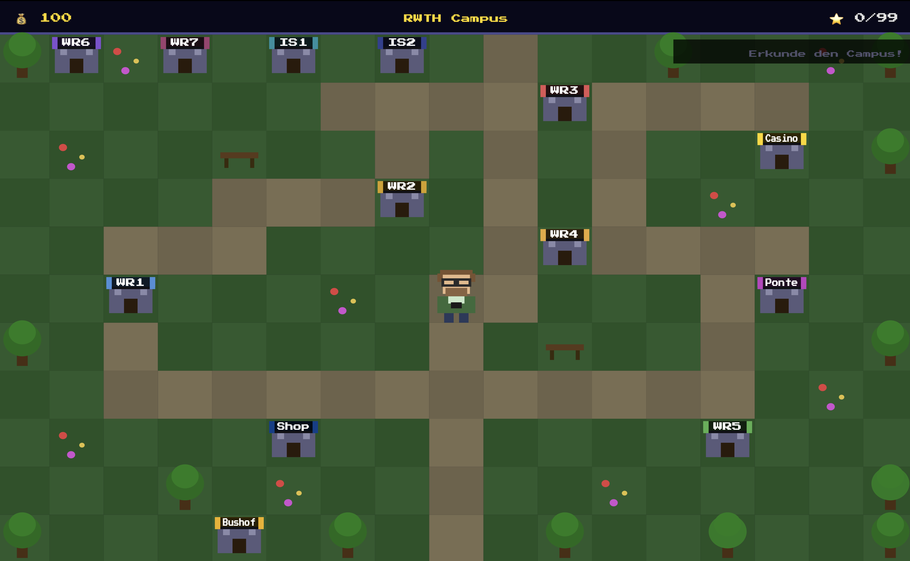

# Prof. Steland's Stochastics Adventure
 
A browser-based pixel-art learning game for the lecture *Introduction to Applied Stochastics* (Einführung in die angewandte Stochastik) at RWTH Aachen University.
 
This project was built as part of a competition held in the lecture *Einführung in die Stochastik* at RWTH Aachen University, where it won **3rd place**.
 
---
##

## Disclaimer
 
The Professor Steland depicted in this game is a fictional character. The real Professor Dr. Steland at RWTH Aachen University is not responsible for its content.
 
---
 
## What is this?
 
A small learning game in which you explore the RWTH campus as a pixel-art character. In the various buildings you can answer quiz questions on the stochastics lectures, earn coins, and either gamble them away in the casino or spend them on new skins.
 
## Bushof Update
Vote for me for the ULTIMATE BUSHOF update!!!
 
## Getting Started
 
### Easiest method: double-click
 
Simply double-click `index.html` in the `files` folder. The game opens directly in your browser. Works fine in Firefox and Safari.
 
> **Chrome:** If the background music in the Ponte doesn't play, this is due to Chrome's local file policies. Either use Firefox or use the local server below.
 
### Alternative: local web server (Python)
 
Open a terminal, navigate to the `files` folder and run:
 
```
python3 -m http.server 8080
```
 
Then open `http://localhost:8080` in your browser.
 
### Or: VS Code Live Server
 
Install the **Live Server** extension, then right-click `index.html` → *Open with Live Server*.
 
---
 
## Controls
 
| Key | Action |
|---|---|
| Arrow keys / WASD | Move |
| Enter / Space | Enter building / confirm quiz answer |
| Escape | Go back / close |
 
---
 
## Tech
 
- Pure vanilla JavaScript, no framework
- Canvas-based pixel-art rendering
- All quiz questions are based on the official lecture slides
- Blackjack with a 6-deck shoe and a basic strategy advisor